# TP2  Les sockets en mode connecté TCP : E/R de CC & objets
## Activité 2-1: Échange de CC entre Client/Serveur via les Sockets TCP

### Objectif

Cette activité consiste à améliorer une application Client/Serveur TCP
afin de permettre l'échange de chaînes de caractères représentant
des opérations arithmétiques complètes.

Le client envoie l'opération au serveur.

Le serveur reçoit l'opération, effectue le calcul et renvoie le résultat.

Le client reçoit ensuite le résultat et l'affiche.

## Étape 1 : Lancement du serveur

Le serveur est lancé avant le client et se met en attente d'une connexion.

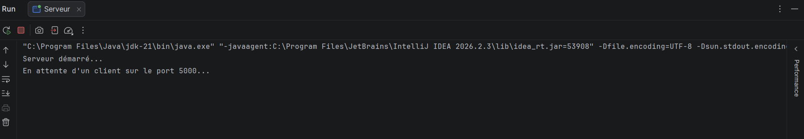

## Étape 2 : Connexion du client

Le client établit une connexion TCP avec le serveur.

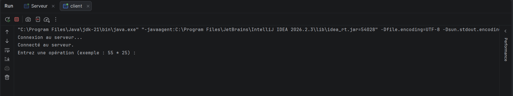

## Étape 3 : Envoi de l'opération

Le client saisit une opération telle que :

55 * 25

L'opération est ensuite envoyée au serveur.

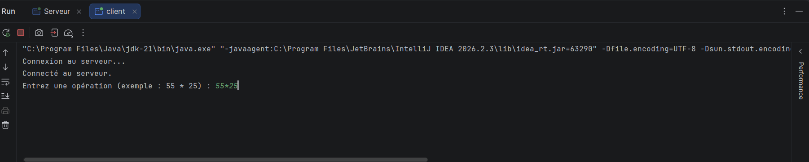

## Étape 4 : Traitement par le serveur

Le serveur reçoit l'opération, réalise le calcul et renvoie le résultat.

Exemple :

55 * 25 = 1375

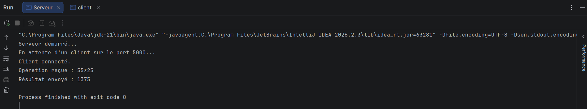
## Étape 5 : Réception du résultat

Le client reçoit le résultat envoyé par le serveur et l'affiche.

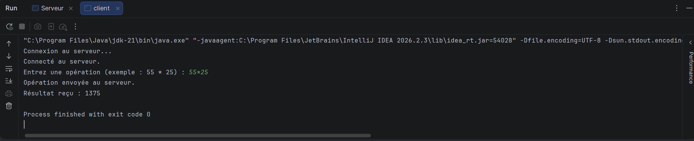

## Tests

Multiplication :
55 * 25 = 1375

Addition :
10 + 20 = 30
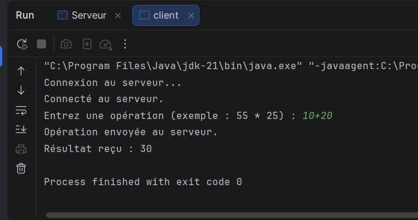

Soustraction :
50 - 15 = 35
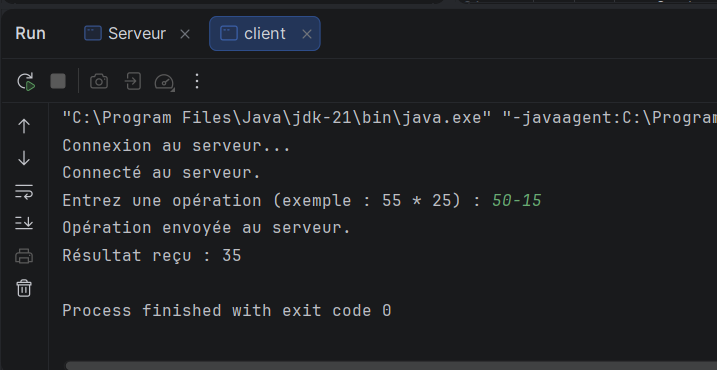

Division :
100 / 4 = 25.0
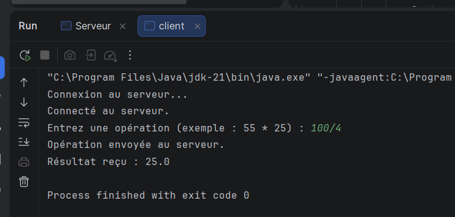

## Conclusion

Cette activité nous a permis de manipuler les sockets TCP en Java
ainsi que les flux de traitement de chaînes de caractères avec
BufferedReader et PrintWriter.

## Activité 2-1: Échange des objets entre Client/Serveur via les Sockets TCP 
### Objectif du TP

L'objectif de cette activité est d'implémenter une communication Client/Serveur en Java à l'aide des sockets TCP, permettant l'échange d'objets grâce à l'interface Serializable.

Le client envoie un objet contenant deux opérandes et un opérateur arithmétique. Le serveur reçoit cet objet, effectue le calcul demandé et renvoie le résultat au client.

### Étape 1 : Préparation de l'espace de travail

Nous avons créé un projet Java dans IntelliJ IDEA contenant trois packages et classes :

Operation.java : représente l'objet à transmettre.

Serveur.java : reçoit l'objet, effectue le calcul et renvoie le résultat.

Client.java : saisit les données, envoie l'objet et affiche le résultat.

Nous avons également créé un fichier README.md pour documenter les différentes étapes.

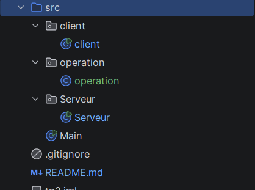
### Étape 2 : Implémentation de l'échange d'objets

a) Création de la classe Serializable

Nous avons créé une classe Operation qui implémente l'interface Serializable.

Cette classe contient trois attributs : le premier opérande, l'opérateur et le deuxième opérande.

L'interface Serializable permet de convertir l'objet en une séquence d'octets afin de le transmettre à travers le réseau.

b) Envoi de l'objet par le client

Le client demande à l'utilisateur de saisir les deux opérandes et l'opérateur (+, -, *, /).

Ensuite, il crée un objet Operation contenant ces informations et l'envoie au serveur à l'aide de ObjectOutputStream et de la méthode writeObject().

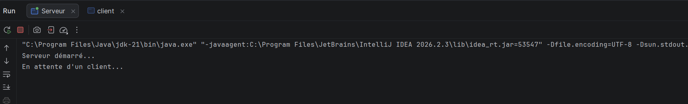

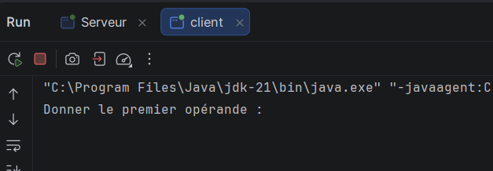

c) Réception de l'objet par le serveur

Le serveur attend la connexion du client à l'aide de la méthode accept().

Après la connexion, il reçoit l'objet envoyé par le client en utilisant ObjectInputStream et la méthode readObject().
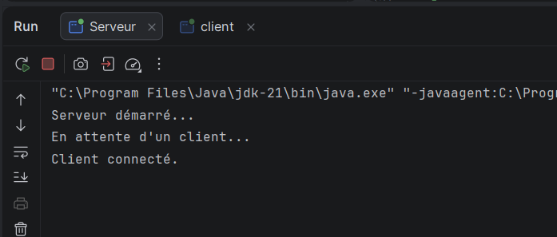

d) Récupération des données

Le serveur récupère les informations de l'objet grâce aux méthodes getOperande1(), getOperateur() et getOperande2().

e) Exécution du calcul

Le serveur utilise une instruction switch pour déterminer l'opération demandée et effectuer le calcul correspondant.

Les opérations prises en charge sont l'addition, la soustraction, la multiplication et la division.

f) Envoi du résultat

Après le calcul, le serveur renvoie le résultat au client à l'aide de ObjectOutputStream.

g) Réception et affichage du résultat

Le client reçoit le résultat grâce à ObjectInputStream, puis l'affiche dans la console.

### Test d'exécution

Nous avons exécuté d'abord le serveur, puis le client.

Exemple de saisie côté client :
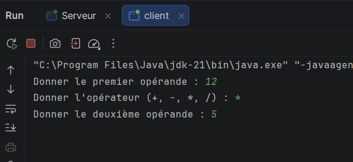

Affichage côté serveur :
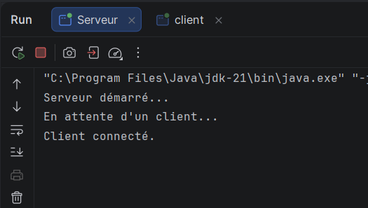

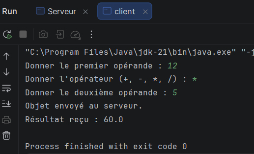

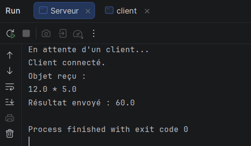

### Conclusion

Cette activité nous a permis de comprendre comment échanger des objets Java entre un client et un serveur en utilisant les sockets TCP.

Nous avons appris à utiliser l'interface Serializable, ainsi que les classes ObjectInputStream et ObjectOutputStream pour transmettre des objets et récupérer les résultats d'un traitement distant